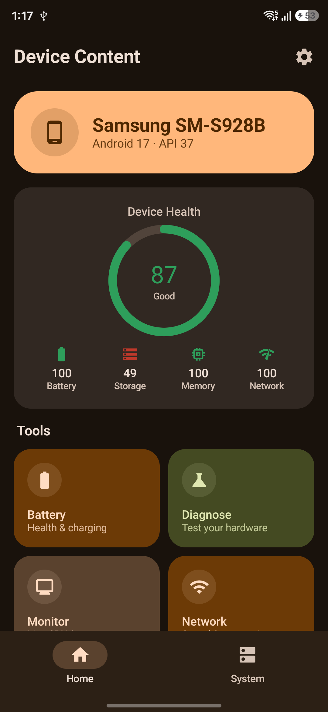
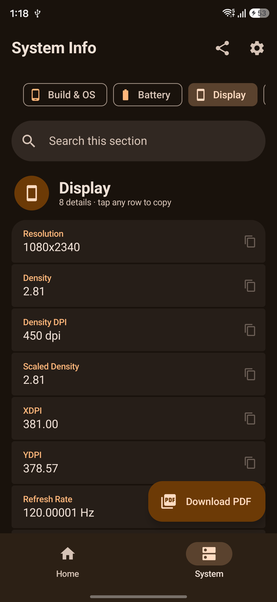
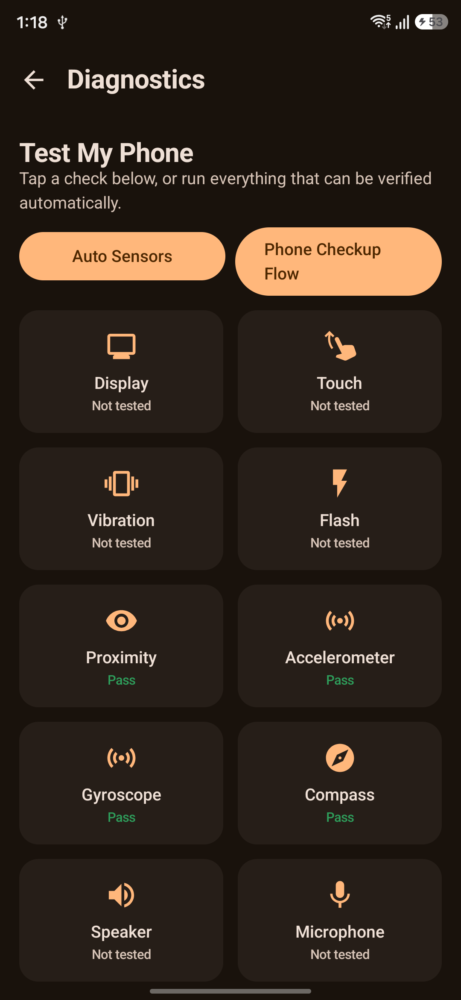
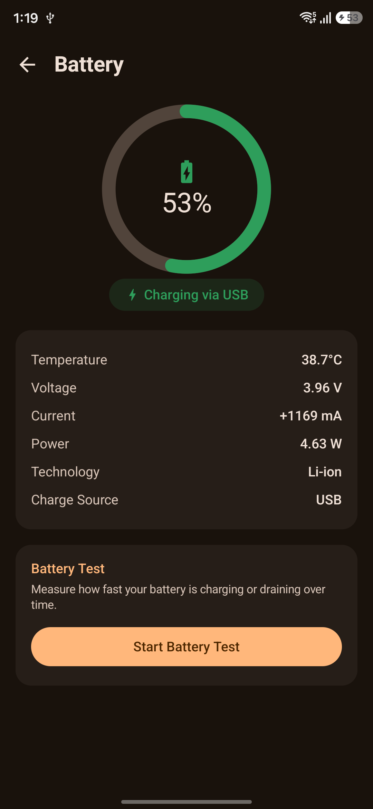
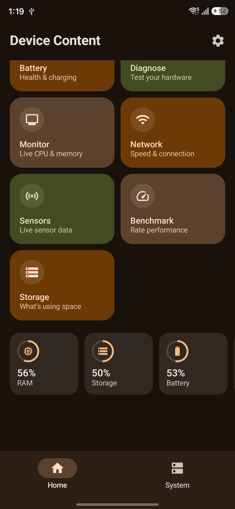
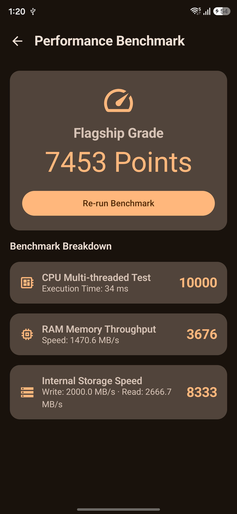
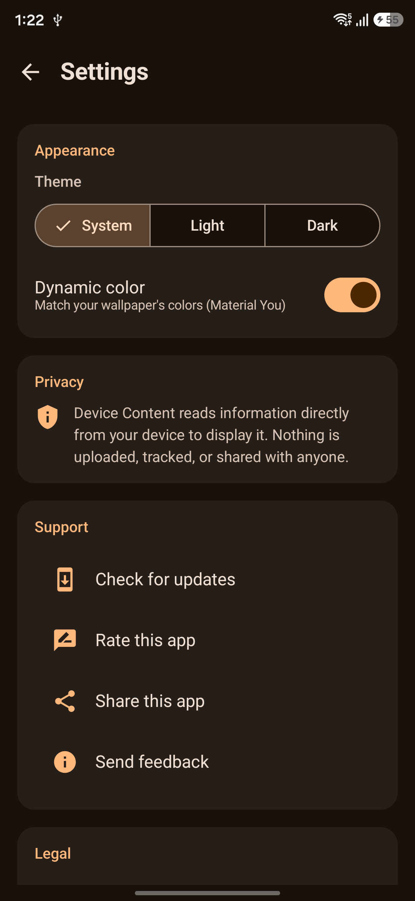
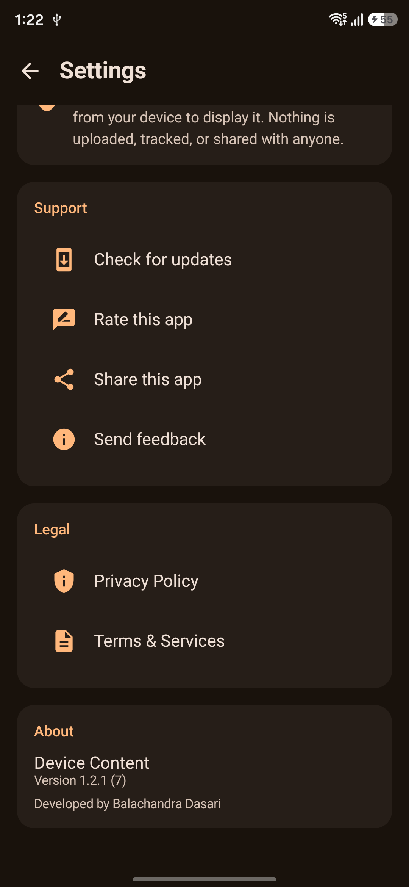

# Device Content

**Know your phone inside out.** Device Content is a fast, private Material 3 app that shows
everything about your device, tests that its hardware works, and tells you at a glance whether
it's healthy. No account and no server: everything stays on your phone.

<a href='https://play.google.com/store/apps/details?id=com.chandra.practice.deviceinfo'>
</a>


## Screenshots

| Home | System Info | Diagnostics |
|:---:|:---:|:---:|
|  |  |  |
| **Battery** | **Tools** | **Benchmark** |
|  |  |  |
| **Settings** | **Settings (more)** | |
|  |  | |

*Dark theme with Material You colours taken from the wallpaper, on a Samsung Galaxy running Android 17.*

## Design highlights

- **Material You colour**: the whole app adopts your wallpaper's colours on Android 12+, with a
  hand-tuned purple palette on older versions, plus light, dark and follow-system themes.
- **Home at a glance**: a device hero card, an animated 0-100 health score with tips, live stat
  rings for RAM, storage and battery, and colour-coded tool cards.
- **System Info that reads well**: each category has an icon header and an item count, details are
  grouped into one rounded card, and tapping any row copies it.
- **Diagnostics that feel like progress**: a "5 of 14 tested" summary with an animated bar, and
  cards that turn green or red as you test.
- **Adapts to every screen**: phones, tablets, foldables and landscape, with a navigation rail on
  wide screens and a readable maximum content width.
- **Polished motion**: animated splash, slide and fade screen transitions, shimmer loading
  placeholders, and animated gauges.
- **Accessible**: content descriptions, large-text support, proper touch targets, and clear
  empty, loading and error states.

- Full documentation (data shown, permissions, developer notes): **[docs/APP_DOCUMENTATION.md](docs/APP_DOCUMENTATION.md)**
- Release history: [CHANGELOG.md](CHANGELOG.md). **Latest: 1.2.1** adds a Home and System Info redesign, tablet/foldable layouts, a Storage Analyzer fix, back-button fixes and smarter in-app updates.

## Features

| Area | What it does |
|---|---|
| **Home** | Device hero card, health score, quick stats (RAM, storage, battery, CPU, network) and shortcuts to every tool. |
| **System info** | Ten searchable categories: Build & OS, Battery, Display, Memory & Storage, CPU & Hardware, Sensors, Camera, Network, App Info, Locale. Copy single values, share a category as text, or export it as PDF. |
| **Battery** | Level, health, temperature, voltage, charging state and technology. |
| **Monitor** | Live CPU and memory sparklines. |
| **Network analyzer** | Connection type, Wi-Fi and IP details. |
| **Sensor explorer** | Live readings from every sensor on the device. |
| **Storage analyzer** | Used/free space plus a breakdown by photos, videos, audio, downloads and apps/system. |
| **Benchmark** | Quick CPU and memory performance scores. |
| **Diagnostics / Phone checkup** | Touch, display, speaker, microphone, camera, flash, vibration, GPS and sensor tests, with an overall checkup result. |
| **Appearance** | Material You dynamic color (Android 12+), light/dark/system theme, phone/tablet/foldable adaptive layout. |
| **Updates** | Play in-app updates with a restart banner. |

## Permissions at a glance

All sensitive permissions are requested **at the moment you open the feature that needs them**,
and the app works without them (that feature just shows a prompt).

| Permission | Used for |
|---|---|
| `CAMERA` | Camera tab, camera test, flash test. No photos or video are saved. |
| `RECORD_AUDIO` | Microphone test (live input level only, nothing recorded or stored). |
| `ACCESS_FINE_LOCATION` / `ACCESS_COARSE_LOCATION` | GPS test. Location is never stored or sent. |
| `READ_MEDIA_IMAGES/VIDEO/AUDIO` (Android 13+), `READ_EXTERNAL_STORAGE` (up to Android 12) | Storage analyzer: totals file **sizes** only. |
| `ACCESS_NETWORK_STATE`, `ACCESS_WIFI_STATE` | Network details. |
| `BLUETOOTH`, `BLUETOOTH_CONNECT` | Bluetooth status in diagnostics. |
| `VIBRATE` | Vibration test. |
| `INTERNET` | Play in-app updates and the online Privacy Policy / Terms page. The app makes no other network calls. |

Details and Play Console notes are in [docs/APP_DOCUMENTATION.md](docs/APP_DOCUMENTATION.md#permissions).

## Tech stack

- Kotlin, single-Activity **Jetpack Compose** UI
- **Material 3** plus `material3-window-size-class` for adaptive layouts
- **MVVM**: `ViewModel` + `StateFlow` per screen
- **DataStore Preferences** for theme and first-run state (no database)
- **Navigation Compose** with animated transitions
- **Play In-App Update** API, `androidx.core.splashscreen`

## Getting started

Requirements: a recent Android Studio, JDK 17, Android SDK with `compileSdk 36` (`minSdk 27`, so
Android 8.1+).

```bash
./gradlew assembleDebug        # debug build
./gradlew testDebugUnitTest    # unit tests
```

### Release signing

The release build reads its keystore from `app/build.gradle.kts`. Do not commit real keystore
passwords. Move them to `local.properties` or environment variables before sharing the repo
(see the developer notes).

## Project structure

```
app/src/main/java/com/chandra/practice/deviceinfo/
├── MainActivity.kt        Compose host, edge-to-edge, splash, in-app update wiring
├── AppContainer.kt        hand-rolled service locator
├── data/
│   ├── model/             DeviceInfoItem, QuickStat, InfoCategory, DiagnosticTest, HealthScore...
│   ├── repository/        DeviceInfo, Benchmark, SensorExplorer, UserPreferences, Diagnostics results
│   ├── health/            DeviceHealthCalculator
│   └── export/            PdfReportExporter
├── update/                InAppUpdateManager
└── ui/
    ├── theme/             Color, Theme, Type, Shape
    ├── components/        reusable composables
    ├── navigation/        Routes, AppNavHost
    ├── permissions/       permission helpers
    └── screens/           home, battery, monitor, network, sensors, storage, benchmark,
                           diagnostics, settings, intro, legal, webview
```

## Privacy

Everything the app reads is displayed locally. Data only leaves the device when you tap Share,
Copy or Export.

- Privacy Policy: Settings → Legal, or https://sites.google.com/view/device-content/home
- Terms & Services: Settings → Legal, or https://sites.google.com/view/devicecontent/home

## Links

- [Google Play](https://play.google.com/store/apps/details?id=com.chandra.practice.deviceinfo)
- [Developer on GitHub](https://github.com/chandra1234456)
